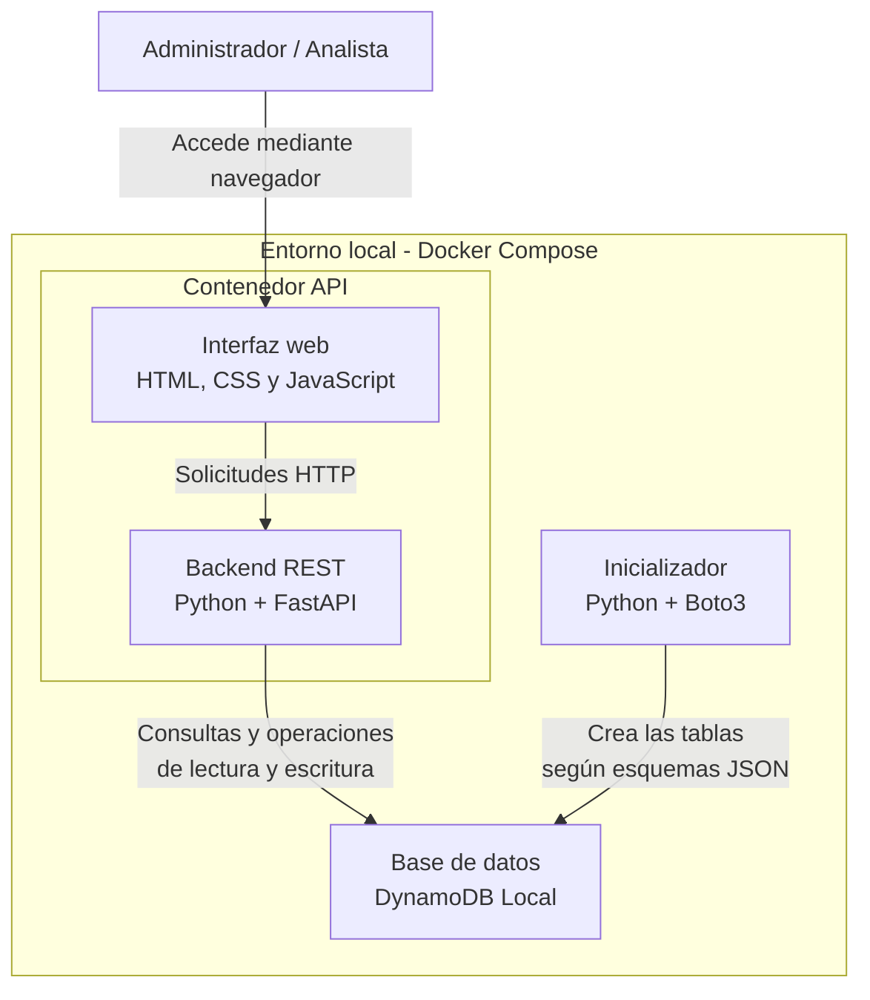

# Diagrama C4 – Nivel 2: Contenedores

## 1. Propósito

Este documento describe la estructura interna de TraceHunt, identificando sus principales componentes tecnológicos, responsabilidades y mecanismos de comunicación.

## 2. Contenedores principales

| Contenedor | Tecnología | Responsabilidad |
|---|---|---|
| Aplicación web | HTML, CSS y JavaScript | Interfaz gráfica para administradores y analistas. |
| Backend API | Python y FastAPI | Gestiona solicitudes HTTP, autenticación, lógica de negocio, simulaciones y detección. También sirve la interfaz web. |
| Base de datos | DynamoDB Local | Almacena usuarios, eventos, alertas, auditorías y simulaciones. |
| Inicializador de base de datos | Python y Boto3 | Crea las tablas necesarias a partir de los esquemas JSON. |

**Nota:** La aplicación web no se ejecuta en un contenedor independiente. FastAPI sirve los archivos del frontend y expone los endpoints de la API desde el mismo servicio.

## 3. Diagrama de contenedores

## 4. Responsabilidades de los componentes

### 4.1. Aplicación web

Desarrollada con HTML, CSS y JavaScript. Proporciona la interfaz desde la cual los usuarios pueden iniciar sesión, ejecutar simulaciones y consultar la información disponible según sus permisos.

La interfaz es servida por FastAPI mediante la ruta `/ui`.

### 4.2. Backend API

Desarrollado con Python y FastAPI. Es responsable de:

- Exponer los endpoints REST.
- Gestionar la autenticación y autorización.
- Ejecutar la lógica de negocio.
- Procesar las simulaciones.
- Aplicar las reglas de detección.
- Consultar y modificar la información almacenada.

También proporciona la documentación interactiva de la API mediante Swagger en `/docs`.

### 4.3. Base de datos

Se utiliza DynamoDB Local para almacenar la información del sistema sin necesidad de conectarse a una instancia de DynamoDB en AWS.

La información se organiza en las siguientes tablas:

- Users
- Events
- Alerts
- AuditLogs
- Simulations

El backend se comunica con la base de datos mediante Boto3.

### 4.4. Inicializador de base de datos

Es un servicio independiente que ejecuta el script `init_tables.py`.

Su responsabilidad es leer los esquemas JSON y crear las tablas necesarias en DynamoDB Local antes de iniciar el backend.

### 4.5. Docker Compose

Coordina los servicios del entorno local, configura variables de entorno, puertos, volúmenes y dependencias entre contenedores.

También permite iniciar y detener el entorno completo mediante un único archivo de configuración.

## 5. Comunicación entre componentes

1. El usuario accede a la aplicación desde el navegador mediante `http://localhost:8080/ui`.
2. La interfaz realiza solicitudes HTTP al backend FastAPI.
3. FastAPI procesa las solicitudes y ejecuta la lógica correspondiente.
4. Cuando se requiere persistencia, el backend utiliza Boto3 para comunicarse con DynamoDB Local.
5. DynamoDB Local almacena o devuelve la información solicitada.
6. El backend entrega la respuesta a la interfaz web.

Antes de iniciar el backend, el servicio inicializador prepara las tablas de la base de datos.

## 6. Puertos utilizados

| Servicio | Puerto del host | Dirección local |
|---|---:|---|
| Backend FastAPI | 8080 | `http://localhost:8080` |
| DynamoDB Local | 8000 | `http://localhost:8000` |

La interfaz web y la API comparten el mismo servicio FastAPI.

## 7. Consideraciones de arquitectura

- Los servicios se ejecutan localmente mediante Docker Compose.
- DynamoDB Local permite desarrollar y probar la aplicación sin utilizar una base de datos administrada en AWS.
- La inicialización de las tablas está separada del backend.
- La arquitectura facilita la portabilidad y la reproducción del entorno de desarrollo.
- Esta descripción corresponde a la arquitectura local; no representa un despliegue en AWS.