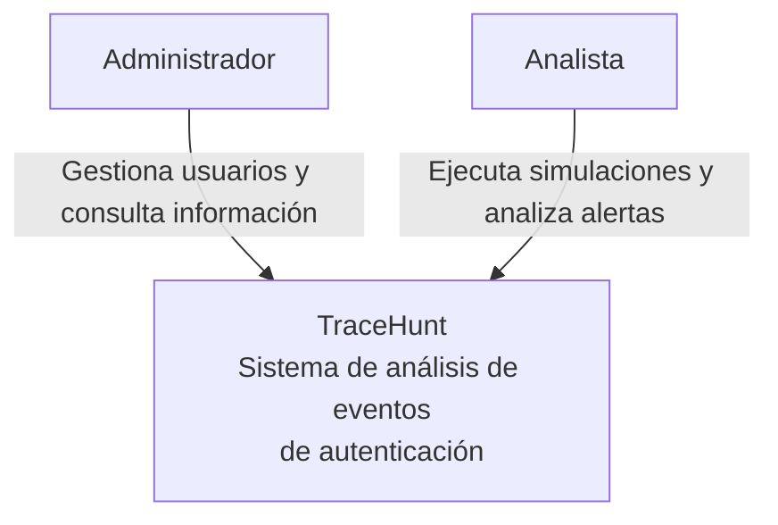

# Diagrama C4 – Nivel 1: Contexto del sistema

## 1. Propósito

Este documento describe TraceHunt desde una perspectiva general, identificando a sus usuarios, su propósito y la forma en que interactúan con el sistema.

## 2. Descripción del sistema

**TraceHunt** es una aplicación orientada al análisis de eventos de autenticación. Permite generar simulaciones de actividad, detectar patrones sospechosos mediante reglas predefinidas y gestionar las alertas generadas.

El sistema está diseñado como un entorno de análisis defensivo. Las alertas representan señales que deben ser revisadas por los analistas, no pruebas definitivas de un ataque.

## 3. Actores principales

| Actor | Descripción |
|---|---|
| Administrador | Gestiona los usuarios y tiene acceso a las funcionalidades administrativas y de análisis. |
| Analista | Ejecuta simulaciones, consulta eventos y revisa las alertas asociadas a sus actividades. |

## 4. Diagrama de contexto

## 5. Interacciones

- El administrador utiliza TraceHunt para gestionar usuarios y consultar información del sistema.
- El analista utiliza la aplicación para ejecutar simulaciones, consultar eventos y revisar alertas.
- TraceHunt procesa los eventos generados por las simulaciones y aplica reglas de detección para identificar comportamientos sospechosos.

## 6. Alcance y límites

Actualmente, TraceHunt funciona como un laboratorio de análisis defensivo. Los eventos son generados mediante un simulador interno y no provienen de sistemas externos de autenticación en producción.

El sistema no bloquea automáticamente cuentas ni realiza acciones de respuesta ante incidentes. Su función es generar alertas para facilitar el análisis por parte de los usuarios autorizados.