# Evidencias de verificación

>Este directorio está reservado para evidencias reproducibles de tareas completadas, como resultados de pruebas, capturas o instrucciones breves para repetir una validación.

## Evidencias: Dockerización de la API de TraceHunt

### Objetivo

Empaquetar la API de TraceHunt en una imagen Docker para ejecutarla dentro de un contenedor, facilitando su despliegue en diferentes entornos sin depender de las instalaciones locales de Python y sus dependencias.

### Procedimiento realizado

Inicialmente, se verificó el funcionamiento de Docker mediante la ejecución de `docker run hello-world`. Esta prueba permitió comprobar que Docker podía descargar una imagen, crear un contenedor y ejecutarlo correctamente.

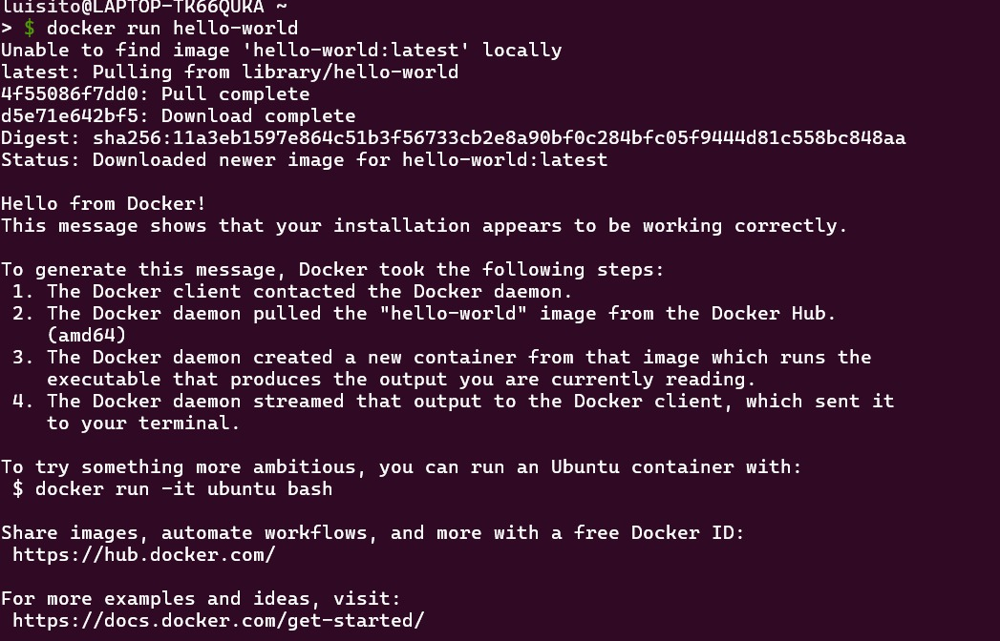

Posteriormente, se construyó la imagen Docker de la API de TraceHunt a partir del archivo `Dockerfile`. Durante este proceso se utilizó una imagen base de Python 3.12 Slim, se estableció el directorio de trabajo `/app`, se instalaron las dependencias definidas en `requirements.txt` y se incorporó el código de la aplicación. Finalmente, se configuró Uvicorn como comando de inicio para ejecutar FastAPI en el puerto 8000 dentro del contenedor.

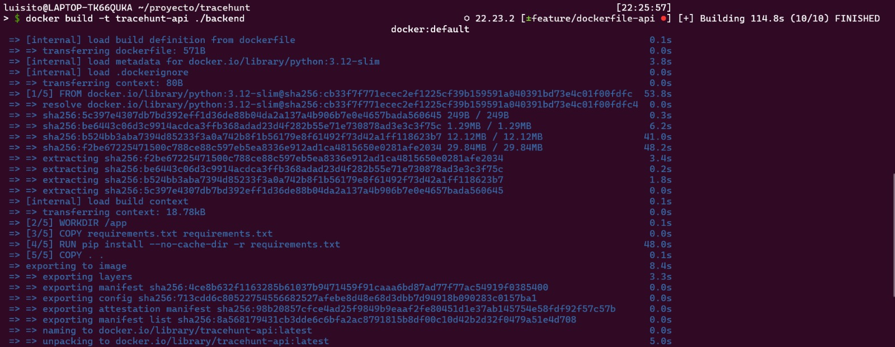

Una vez construida la imagen, se ejecutó la API mediante un contenedor Docker, publicando el puerto 8000 del contenedor en el puerto 8080 del equipo anfitrión. Se verificó el estado del contenedor y se consultaron los registros de ejecución para comprobar que Uvicorn iniciara correctamente. Además, se realizaron solicitudes a los endpoints `/health` y `/docs`, obteniendo respuestas HTTP 200 OK.

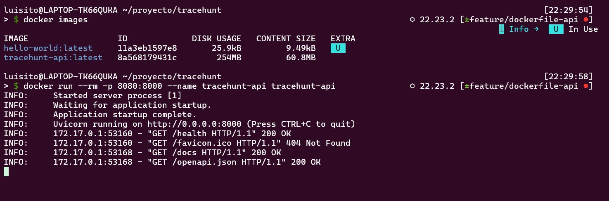

### Resultado

La tarea permitió construir una imagen Docker de la API de TraceHunt y ejecutarla en un contenedor funcional. Se comprobó el acceso a los endpoints mediante el puerto publicado y se verificó el inicio correcto del servidor. Con ello, se cumplió el objetivo de ejecutar la API en Docker.

## Evidencias: Orquestación de TraceHunt con Docker Compose

### Objetivo

Configurar y ejecutar conjuntamente la API de TraceHunt y DynamoDB Local mediante Docker Compose, definiendo sus servicios, variables de entorno, puertos, red de comunicación y almacenamiento persistente.

### Procedimiento realizado

Inicialmente, se verificó la configuración definida en el archivo `docker-compose.yml` mediante el comando `docker compose config`. Esta validación permitió comprobar la configuración de los servicios `api` y `dynamodb-local`, las variables de entorno, los puertos publicados y el volumen utilizado para almacenar los datos de DynamoDB Local.

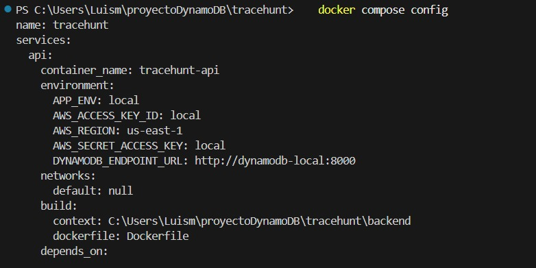

Posteriormente, se ejecutó el comando `docker compose up --build` para construir la imagen de la API y levantar los servicios definidos. Docker Compose descargó la imagen `amazon/dynamodb-local`, construyó la imagen de TraceHunt a partir del `Dockerfile` y creó los contenedores y la red compartida para permitir la comunicación entre ambos servicios.

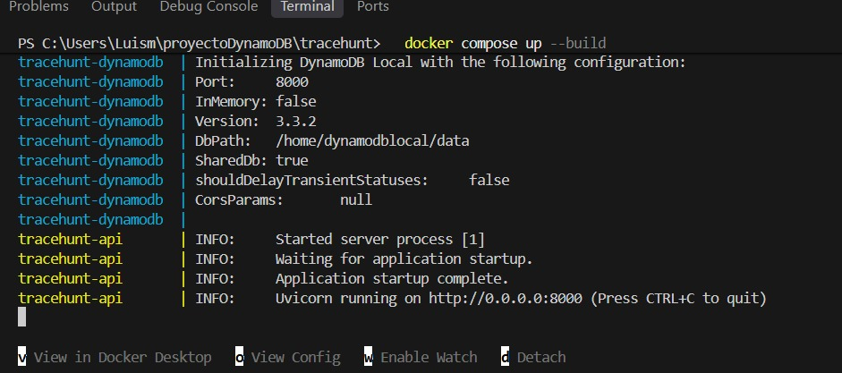

Durante el inicio, se verificó en los registros que DynamoDB Local se inicializara en el puerto 8000 y que Uvicorn iniciara correctamente la API dentro de su contenedor. La API quedó accesible desde el equipo anfitrión mediante el puerto 8080, mientras que la conexión interna con DynamoDB Local se configuró mediante la dirección `http://dynamodb-local:8000`.

Finalmente, se consultó el estado de los servicios mediante `docker compose ps`, comprobando la creación de los contenedores y sus puertos publicados.

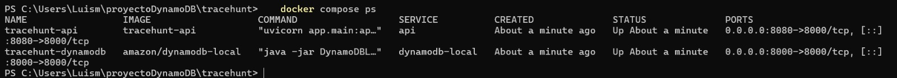

### Resultado

Se configuró la orquestación local de TraceHunt mediante Docker Compose, integrando la API y DynamoDB Local en una misma red. La configuración permite iniciar ambos servicios con un único comando y establece el almacenamiento persistente para los datos de la base de datos local. Los registros confirmaron el inicio de los procesos de la API y de DynamoDB Local.

Esta evidencia demuestra la configuración y el arranque de los servicios. La comunicación funcional entre la API y DynamoDB Local debe validarse adicionalmente mediante una operación real de lectura o escritura.

## Evidencias: Integración con DynamoDB mediante Boto3

### Objetivo

Verificar la conexión con DynamoDB Local mediante Boto3 y comprobar la creación de tablas y el registro de datos desde Python.

### 1. Prueba de conexión y registro mediante Boto3

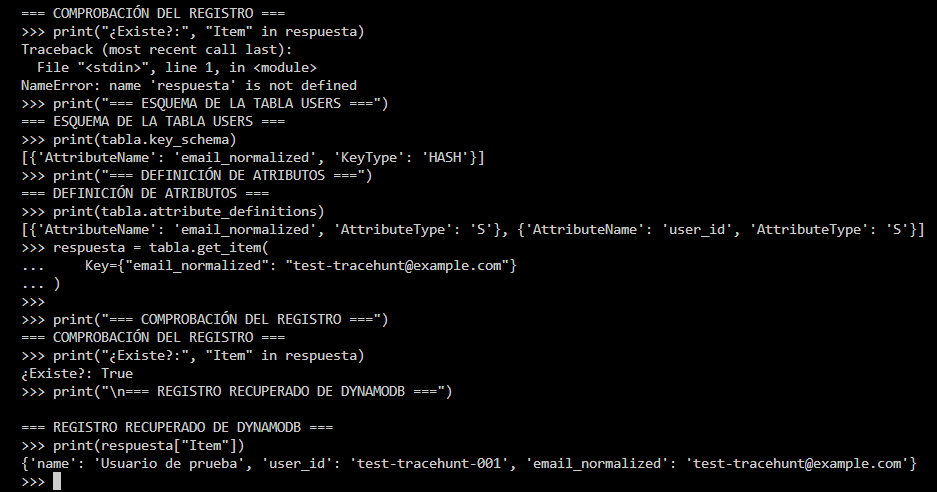

Esta evidencia muestra la ejecución de una prueba en Python utilizando Boto3 para interactuar con DynamoDB. Se verifica la operación de registro de datos realizada desde el código Python.

### 2. Tablas creadas en DynamoDB

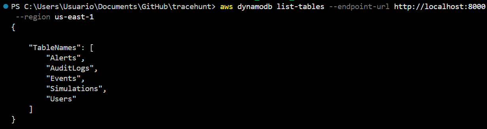

Esta evidencia muestra las tablas creadas en DynamoDB Local, permitiendo comprobar la existencia de las estructuras de almacenamiento configuradas para el proyecto TraceHunt.

### Resultado

Las evidencias documentan la interacción de Python con DynamoDB mediante Boto3 y la visualización de las tablas creadas para el proyecto. En conjunto, permiten respaldar las pruebas de integración con la base de datos local.

## Evidencias: Autenticación y validación de JWT

### Objetivo

Documentar las pruebas de generación y validación de tokens JWT, incluyendo la verificación de su firma, la detección de modificaciones en el contenido y el rechazo de tokens expirados.

### 1. Generación del hash de contraseña

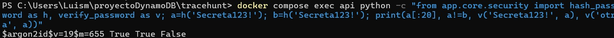

Esta evidencia muestra el proceso de generación de un hash para una contraseña. El hash permite almacenar la contraseña de forma segura, evitando guardar su valor original en texto plano.

### 2. Validación de un token válido

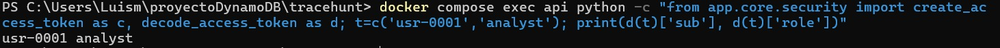

Esta prueba verifica que un token JWT con una firma válida y que cumple las condiciones de validación sea aceptado por la aplicación.

### 3. Rechazo de un token alterado

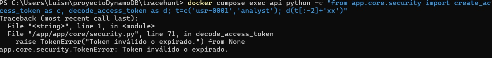

Esta evidencia demuestra la validación de la firma del JWT. Cuando se modifica el contenido del token sin generar una firma válida correspondiente, la verificación debe fallar y el token debe ser rechazado.

### 4. Rechazo de un token expirado

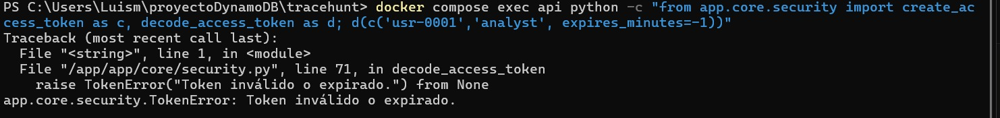

Esta prueba comprueba que la aplicación rechace un token cuya fecha de expiración (`exp`) ya ha pasado, aunque su firma sea válida.

### Resultado

Las evidencias documentan las pruebas de generación de hashes de contraseñas y de validación de JWT. Se contemplan tres escenarios para los tokens: aceptación de un token válido, rechazo de un token alterado y rechazo de un token expirado.

Estas pruebas contribuyen a verificar la integridad y la vigencia de los tokens utilizados en la autenticación de TraceHunt.

## 5. CONSTRUCCIÓN DE DOCKER

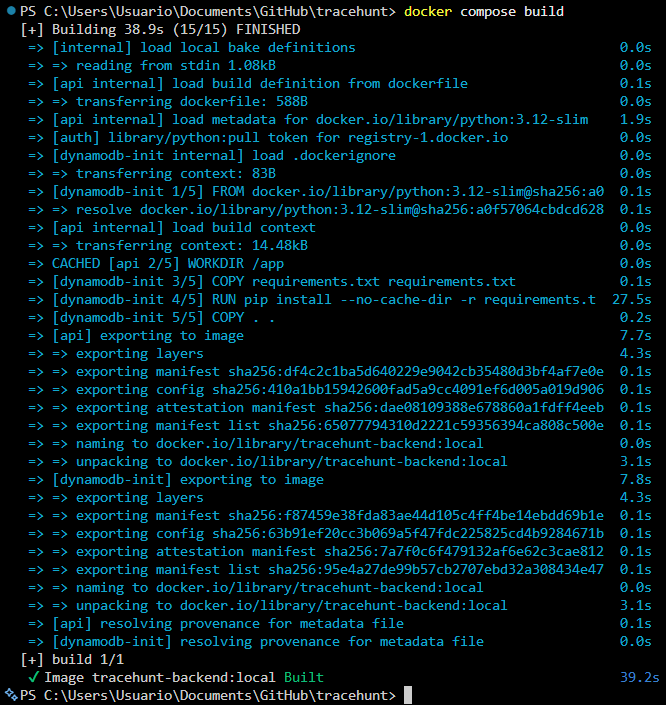

Esta prueba verifica la construcción de las imágenes de Docker necesarias para ejecutar los servicios de TraceHunt, incluyendo la API y el inicializador de tablas de DynamoDB. Durante este proceso se instalan las dependencias y se incorporan los archivos necesarios para ejecutar los componentes del proyecto.

### Resultado

La construcción de las imágenes finalizó correctamente, preparando los servicios necesarios para ejecutar la API y automatizar la inicialización de las tablas de DynamoDB.

## 6. EJECUCIÓN DE DOCKER COMPOSE

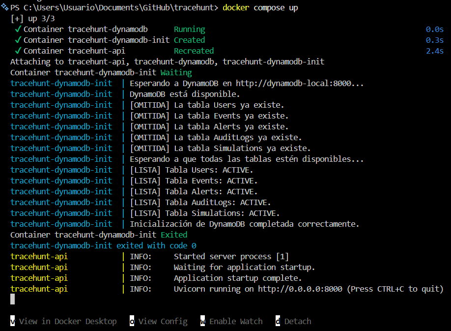

Esta prueba verifica el arranque de los servicios definidos en el archivo `docker-compose.yml`. Durante la ejecución, Docker Compose inicia DynamoDB Local y ejecuta el inicializador de tablas antes de permitir que la API de TraceHunt comience a funcionar.

### Resultado

Los servicios se iniciaron correctamente. El inicializador verificó la disponibilidad de las tablas de DynamoDB y finalizó satisfactoriamente. Después, la API completó su proceso de arranque y quedó disponible para recibir solicitudes.

## 7. VERIFICACIÓN DE LAS TABLAS DE DYNAMODB

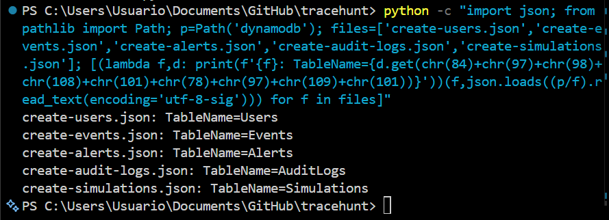

Esta prueba verifica el funcionamiento del inicializador encargado de leer las definiciones de las tablas desde los archivos JSON del proyecto. El proceso comprueba la existencia y disponibilidad de las tablas `Users`, `Events`, `Alerts`, `AuditLogs` y `Simulations`, evitando intentar crear nuevamente aquellas que ya existen.

### Resultado

El inicializador reconoció las cinco tablas existentes y confirmó que todas se encontraban en estado `ACTIVE`. El proceso terminó correctamente con código de salida `0`, indicando que la verificación de las tablas se completó sin errores.

## 8. VISUALIZACIÓN DE LOS REGISTROS DE DOCKER

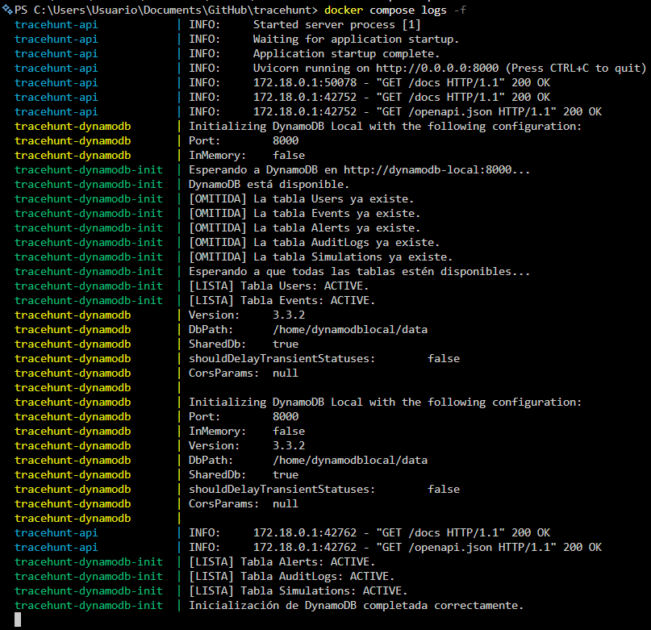

Esta prueba muestra la consulta de los registros de los contenedores mediante Docker Compose. Los registros permiten observar los mensajes generados durante la inicialización de DynamoDB y el arranque de la API, facilitando el seguimiento del proceso y la identificación de posibles errores.

### Resultado

Los registros permitieron comprobar que el inicializador terminó correctamente y que la API inició después de completar la verificación de las tablas. Esta información facilita el diagnóstico de problemas durante el arranque de los servicios.

### Evidencias de autenticación

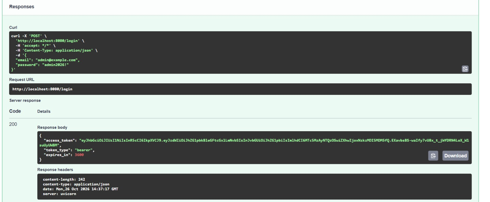

Demuestra que el administrador puede iniciar sesión con credenciales válidas y obtener un token de acceso.

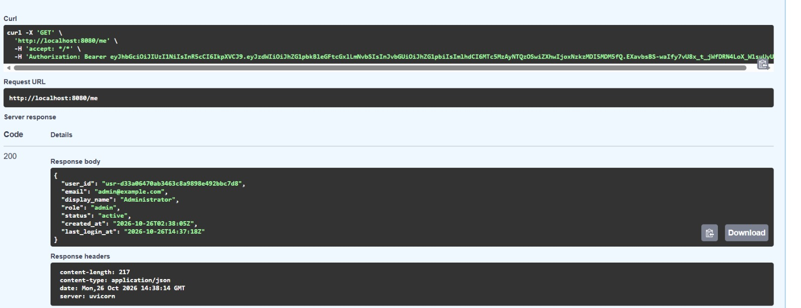

Demuestra que el endpoint `GET /auth/me` devuelve la información del usuario autenticado sin exponer `password_hash`.

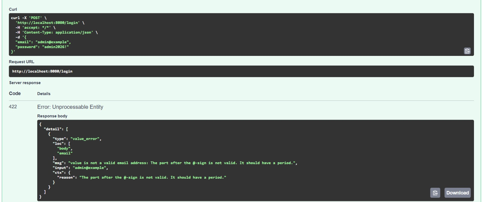

Demuestra que el sistema rechaza el inicio de sesión cuando el correo electrónico no está registrado.

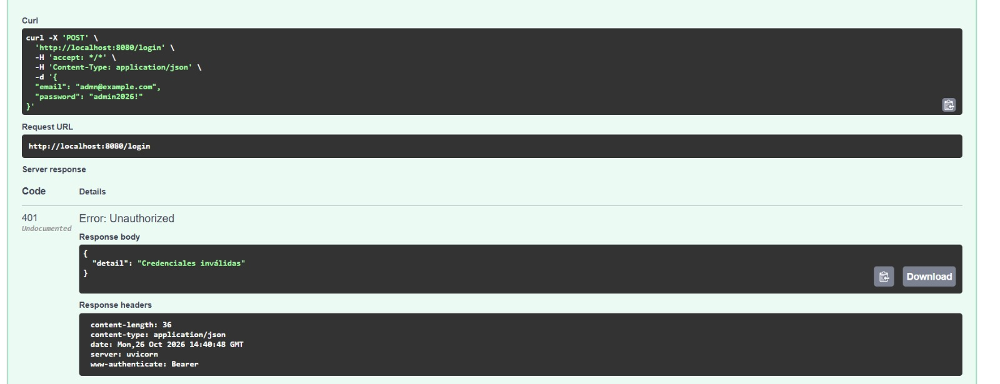

Demuestra que el sistema rechaza el inicio de sesión cuando la contraseña proporcionada es incorrecta.

### Evidencias de administración de usuarios y autenticación

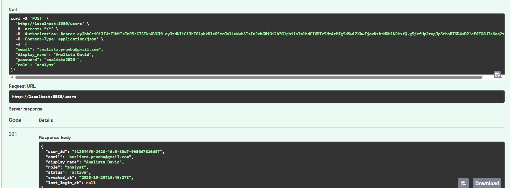

Demuestra la creación exitosa de un usuario con los datos y el rol asignados.

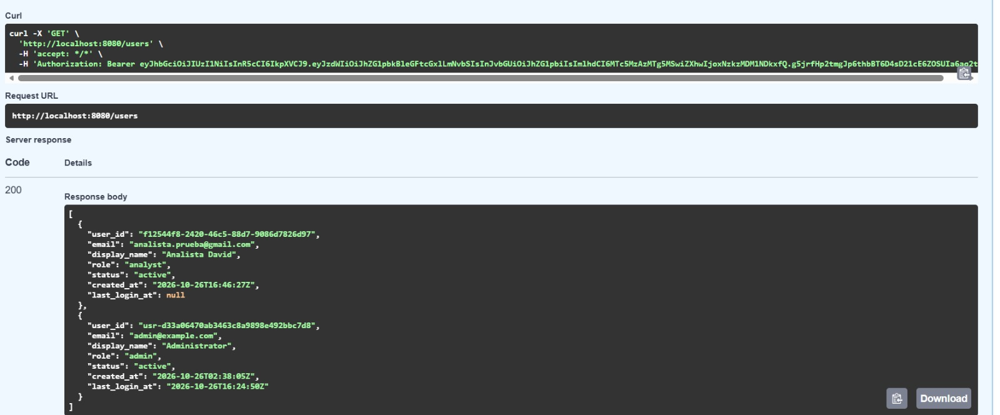

Demuestra que el administrador puede consultar los usuarios registrados sin exponer contraseñas ni hashes.

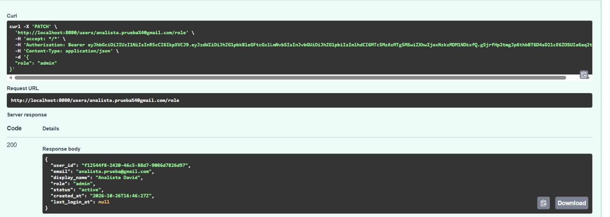

Demuestra que el administrador puede modificar el rol de un usuario entre `admin` y `analyst`.

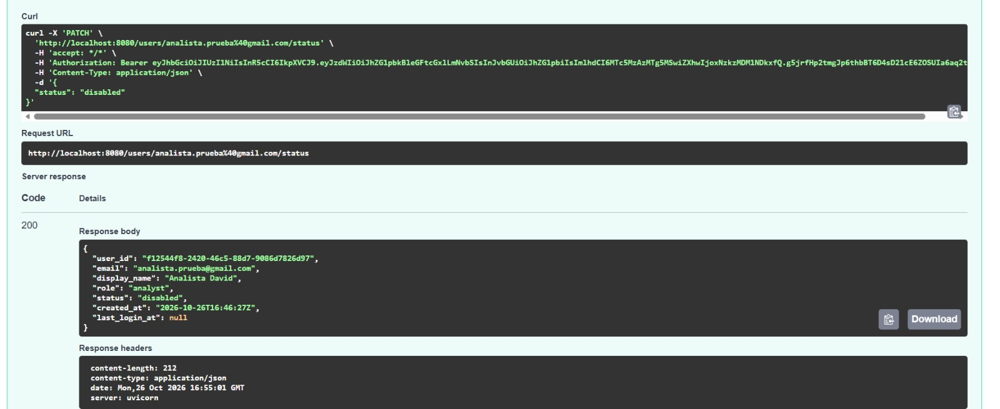

Demuestra que el administrador puede activar y desactivar una cuenta de usuario.

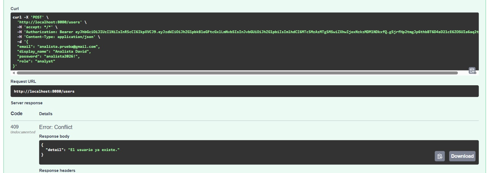

Demuestra que el sistema rechaza la creación de una cuenta con un correo electrónico ya registrado.

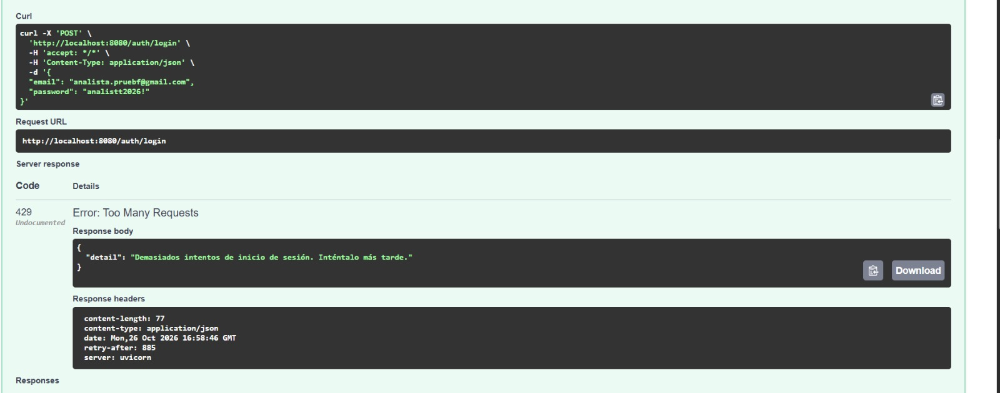

Demuestra que el sistema limita los intentos fallidos de inicio de sesión y responde con `429 Too Many Requests` al superar el umbral configurado.
### Evidencia: Creación del administrador inicial

Se verifica la creación de la cuenta administradora inicial en DynamoDB. Se comprueba que el usuario existe, tiene el rol `admin` y su estado es `active`.

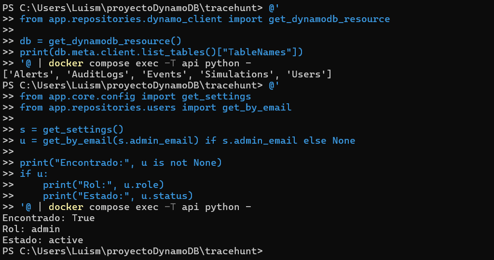

### PRUEBAS UNITARIAS DE ESCENARIOS

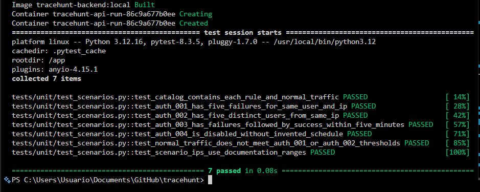

Estas pruebas verifican el catálogo de escenarios, los patrones de las reglas AUTH-001, AUTH-002 y AUTH-003, el estado desactivado de AUTH-004 y el tráfico normal.

#### Resultado

Las 7 pruebas finalizaron correctamente en 0.08 segundos.

### PRUEBAS DEL REPOSITORIO DE SIMULACIONES

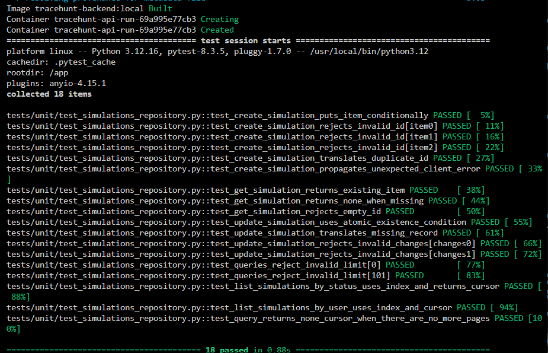

Estas pruebas verifican la creación condicional de simulaciones, el manejo de identificadores duplicados e inválidos, las consultas y las actualizaciones paginadas.

#### Resultado

Las 18 pruebas finalizaron correctamente en 0.88 segundos.

### EJECUCIÓN DE PRUEBAS UNITARIAS

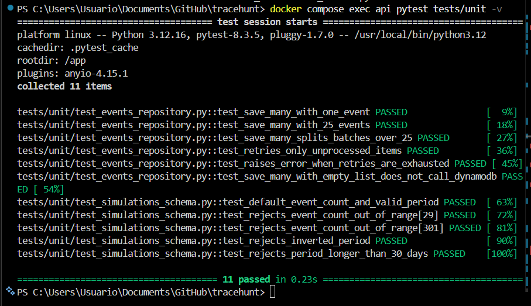

La ejecución muestra pruebas del repositorio de eventos y del esquema de simulaciones, incluyendo escrituras por lotes, reintentos de elementos no procesados y validación de parámetros.

#### Resultado

Las 11 pruebas finalizaron correctamente en 0.23 segundos.

### PRUEBAS DEL ESQUEMA DE SIMULACIONES

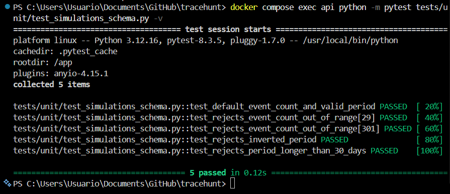

Estas pruebas verifican los valores predeterminados y rechazan cantidades de eventos fuera de rango, periodos invertidos y periodos mayores a 30 días.

#### Resultado

Las 5 pruebas finalizaron correctamente en 0.12 segundos.

### PRUEBAS DEL REPOSITORIO DE EVENTOS

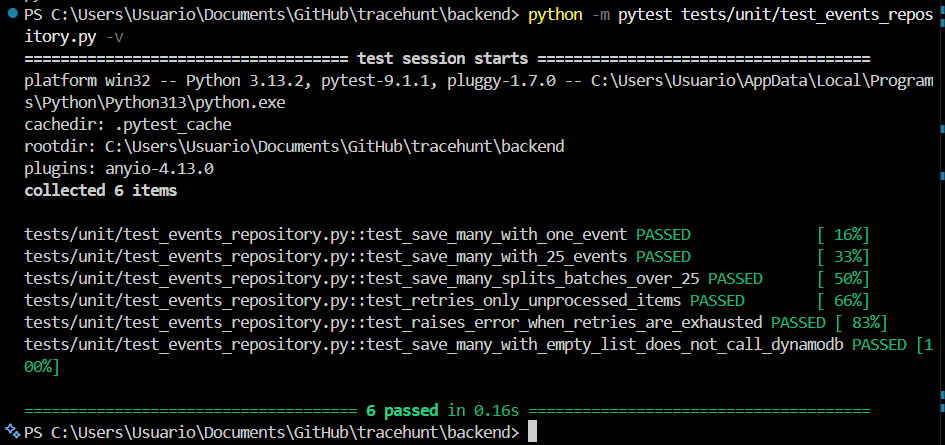

Estas pruebas verifican la escritura de eventos en lotes, la división de lotes mayores a 25 elementos, los reintentos de `UnprocessedItems` y el manejo del agotamiento de reintentos.

#### Resultado

Las 6 pruebas finalizaron correctamente en 0.16 segundos.

### PRUEBAS DEL SERVICIO DE SIMULACIONES

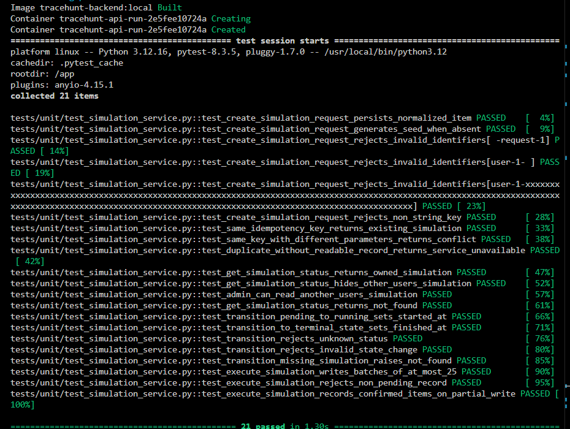

Estas pruebas verifican la creación idempotente de solicitudes, la validación de parámetros, el acceso según el propietario, las transiciones de estado y la escritura de eventos en lotes.

#### Resultado

Las 21 pruebas finalizaron correctamente en 1.30 segundos.

### PRUEBAS DEL GENERADOR DE EVENTOS

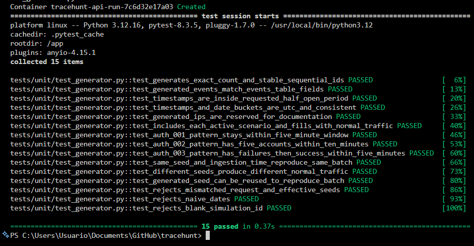

Estas pruebas verifican la cantidad generada, los IDs estables, los campos de los eventos, los rangos temporales, las IP reservadas, los escenarios y la reproducibilidad mediante seed.

#### Resultado

Las 15 pruebas finalizaron correctamente en 0.37 segundos.

## Evidencias del simulador

Las siguientes capturas muestran las pruebas realizadas sobre los endpoints del simulador de TraceHunt mediante Swagger UI. Se documentan la gestión de errores, la generación de simulaciones, la consulta del listado, la búsqueda por identificador y el comportamiento de la idempotencia.

### 1. Manejo de errores (`errorMes`)

Se evidencia la respuesta de la API ante una solicitud que genera un error, verificando el código HTTP y el mensaje devuelto al cliente.

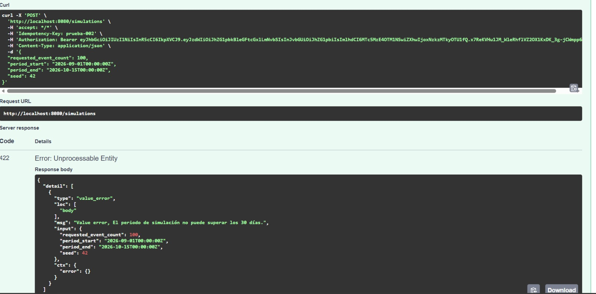

### 2. Generación de simulaciones (`generarSimulador`)

Se muestra la solicitud para crear y ejecutar una simulación, junto con la respuesta que contiene su identificador, estado y resultados disponibles.

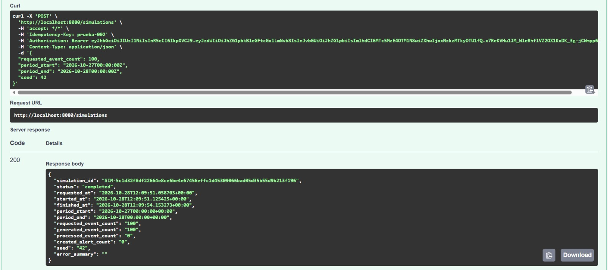

### 3. Listado de simulaciones (`listarSimulacion`)

Se evidencia la consulta de las simulaciones asociadas al usuario autenticado, incluyendo los elementos devueltos y la información de paginación cuando corresponde.

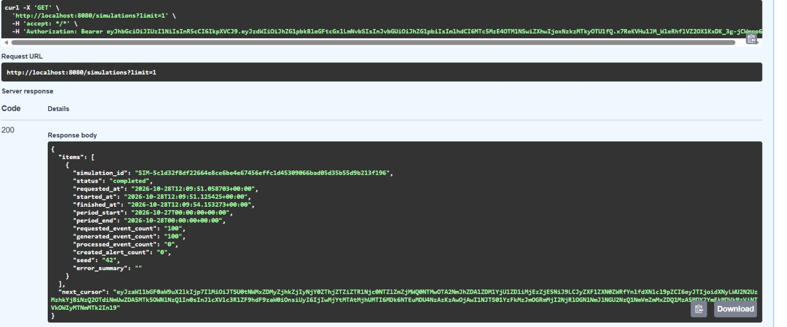

### 4. Consulta por identificador (`simuladorId`)

Se muestra la consulta de una simulación específica mediante su identificador, permitiendo revisar su estado y los resultados expuestos por la API.

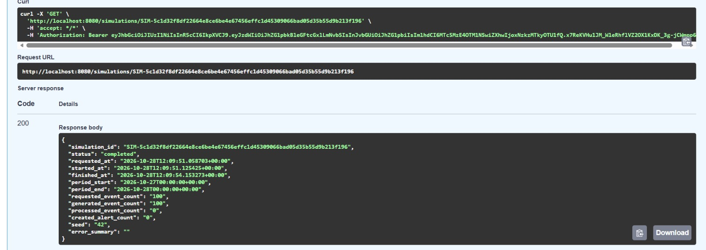

### 5. Idempotencia (`simuladorIdempotencia`)

Se documenta la prueba de solicitudes repetidas utilizando la misma clave de idempotencia, para verificar que el sistema evita crear simulaciones duplicadas y gestiona correctamente la reutilización de la clave.

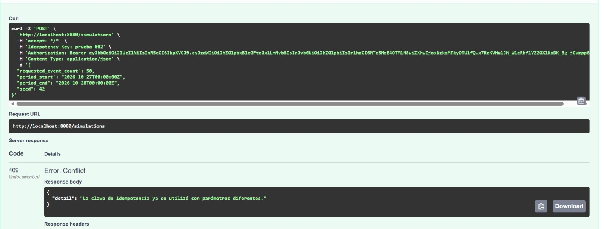
